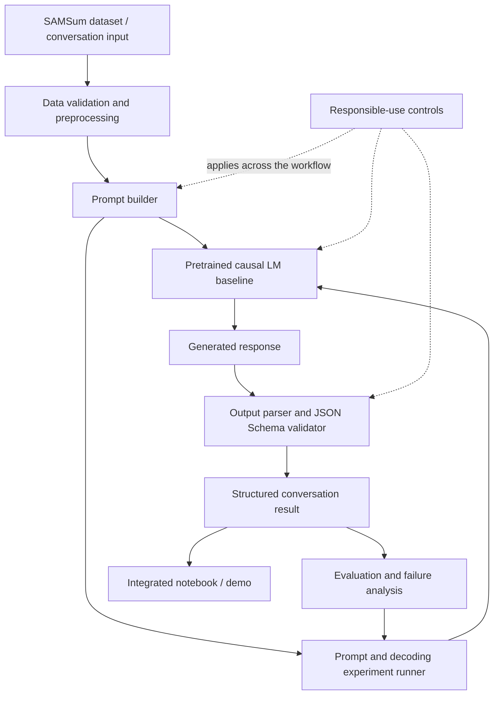
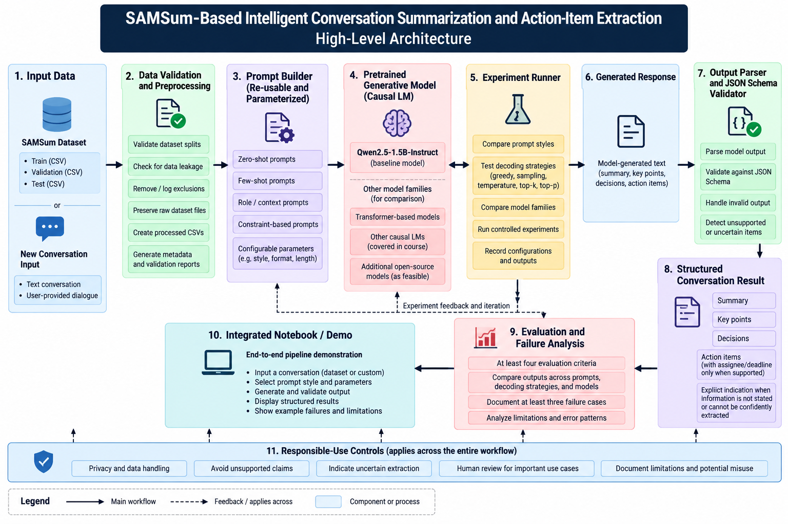
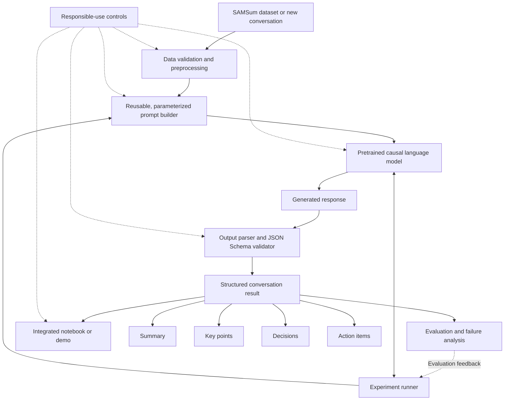

# SAMSum-Based Intelligent Conversation Summarization and Action-Item Extraction

## 1. Purpose

Define the high-level architecture for Group 19's Applied Generative AI major project. The system will summarize conversations and extract key points, decisions, and action items using pretrained generative models and controlled prompting.

## 2. Architecture Status

This document defines the intended architecture. A component is not considered implemented or verified merely because it appears in this diagram. Implementation status must be updated using code, experiment outputs, and tests as evidence.

## 3. High-Level Architecture

## 4. Component Responsibilities

| Component | Responsibility | Evidence expected |
|---|---|---|
| Dataset validation and preprocessing | Validate splits, document exclusions, preserve raw data, produce processed CSVs | Validation output, preprocessing metadata, exclusion log |
| Prompt builder | Apply reusable prompts for zero-shot, few-shot, role/context, and constraint styles | Versioned prompt templates and experiment logs |
| Pretrained causal LM baseline | Generate initial summaries using a pretrained model; do not train an LLM from scratch | At least three saved example outputs and configuration |
| Experiment runner | Compare prompt styles, decoding strategies, and selected model families | Reproducible experiment configurations and results |
| Output parser and JSON Schema validator | Parse structured responses and detect invalid output | JSON Schema and positive/negative validation tests |
| Structured conversation result | Represent summary, key points, decisions, and action items | Documented output contract and examples |
| Evaluation and failure analysis | Assess quality using at least four criteria and document at least three failure cases | Evaluation results, examples, limitations |
| Integrated notebook/demo | Connect input, generation, validation, and display of results | Runnable notebook or demonstration |
| Responsible-use controls | Address privacy, unsupported claims, uncertain extraction, and human review | Documented controls and tested examples where applicable |

## 5. Intended Output Contract

The generated result should contain:

- Summary
- Key points
- Decisions
- Action items, including an assignee or deadline only when supported by the conversation
- An explicit indication when an item is not stated or cannot be confidently extracted, where the output design supports it

Generated content must not be treated as verified fact automatically. Evaluation and human review remain important.

## 6. Experiment Design

The project will use Qwen2.5-1.5B-Instruct as the initial pretrained baseline. Other model families and model choices will be selected based on course coverage, feasibility on the available CPU-only environment, and documented technical justification.

Experiments should isolate relevant variables where practical, record their configurations, and retain representative outputs. The test split must remain reserved for final evaluation; use training and validation data for development decisions.

Required comparisons include:

- At least four prompt styles: zero-shot, few-shot, role/context, and constraint-based
- Greedy decoding versus sampling, including temperature, top-k, and top-p where supported
- At least three generative model families covered in the course
- Conceptual comparison of prompting, RAG, fine-tuning, and PEFT

## 7. Key Design Constraints

- Preserve the original raw dataset files.
- Do not claim a component works until it has been tested.
- Do not make unsupported accuracy or quality claims.
- Record design decisions with experimental evidence, observations, or technical justification.
- Validate structured outputs instead of assuming generated JSON is valid.
- Do not train a large language model from scratch.
- Keep experiments reproducible and document exclusions, configurations, and failures.

## 8. Current Implementation Evidence

Already completed and documented:

- Raw dataset audit and split-leakage checks
- Dialogue and summary length profiling
- Token-length profiling using the Qwen2.5-1.5B-Instruct tokenizer
- Processed CSV creation and independent validation
- Exclusion logging for the training record with a missing dialogue
- SHA-256 baseline and subsequent integrity verification for all three raw CSVs
- Successful Qwen2.5-1.5B-Instruct smoke test on CPU

These completed items do not imply that prompt comparisons, model-family comparisons, structured output validation, the tool demo, or final evaluation are complete.

## 9. Next Architecture Updates

As implementation proceeds, record:

- Actual source files and entry points for each component
- Model and prompt configurations used
- Tests and experiment evidence
- Known limitations and failure modes
- Component status: Planned, Implemented, or Tested

## 10. Visual High-Level Architecture

The following diagram illustrates the complete intended system architecture, from conversation input to structured output, evaluation, and demonstration.

## 11. Textual High-Level Architecture

### Architecture flow

1. **Input and preprocessing:** Validate the SAMSum data or prepare a new conversation.
2. **Reusable prompting:** Construct prompts from configurable templates.
3. **Model execution:** Generate responses using a pretrained causal language model.
4. **Output validation:** Parse responses and validate structured output against a JSON Schema.
5. **Structured results:** Produce a summary, key points, decisions, and action items.
6. **Evaluation and demonstration:** Evaluate quality and show the end-to-end workflow.
7. **Responsible use:** Apply privacy, uncertainty, human-review, and unsupported-claim controls throughout the system.

**Status note:** This is the intended architecture. Components must be marked implemented or tested only when supported by actual code and verification evidence.
