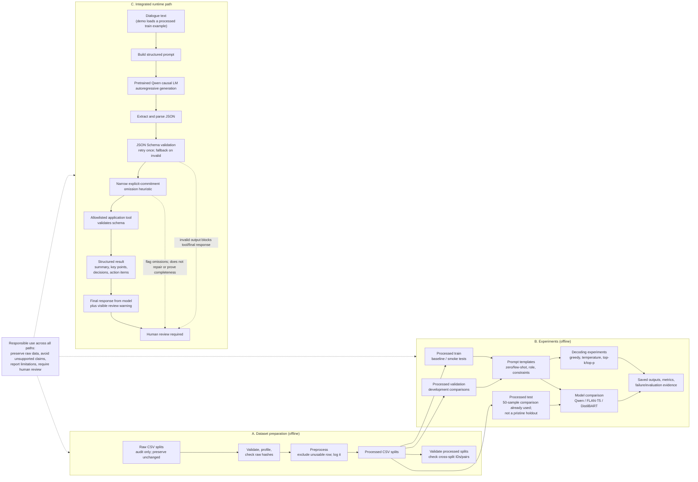

# SAMSum-Based Intelligent Conversation Summarization and Action-Item Extraction

## 1. Purpose

Describe the implemented architecture for Group 19's Applied Generative AI project: conversation summarization and extraction of key points, decisions, and action items using pretrained generative models and controlled prompting.

## 2. Architecture Status

This diagram reflects the implemented project as verified on 28 October 2026. It distinguishes the offline dataset/experiment workflow from the integrated runtime path. The current model is pretrained and used for inference; this project does not train or fine-tune its parameters.

## 3. High-Level Architecture

## 4. Component Responsibilities

| Component | Responsibility | Evidence expected |
|---|---|---|
| Dataset validation and preprocessing | Read raw files for audits/preprocessing; keep them unchanged; write processed CSVs and exclusions | Validation output, preprocessing metadata, exclusion log, hash report |
| Prompt builder | Apply reusable prompts for zero-shot, few-shot, role/context, and constraint styles | Versioned prompt templates and experiment logs |
| Pretrained causal LM baseline | Generate summaries with pretrained Qwen; no parameter training or fine-tuning | Three saved training-example outputs and run configuration |
| Experiment runners | Compare prompt/decoding settings and three tested model configurations; record metrics and limitations | Experiment configurations, manifests, outputs, comparison tables |
| Output parser and JSON Schema validator | Parse JSON; validate required summary/key points/decisions/action items; retry invalid JSON once and flag fallback | JSON Schema and positive/negative tests |
| Commitment-coverage warning | Flag a limited pattern of unrepresented first-person commitments for review; does not correct output or guarantee factuality | Unit tests and integrated demo warning |
| Allowlisted validation tool | Validate model-produced structured output; return result to model for final response; block follow-up if validation fails | Tool specification, round-trip evidence, tests |
| Structured conversation result | Represent summary, key points, decisions, and action items | Documented output contract and examples |
| Evaluation and failure analysis | Assess quality using at least four criteria and document at least three failure cases | Evaluation results, examples, limitations |
| Integrated notebook/demo | Connect a dialogue, structured generation, validation tool, final response, and review warnings | Executed notebook, CLI output, saved integrated result |
| Responsible-use controls | Preserve raw data; disclose uncertain or unsupported output, test-split reuse, privacy needs, and review requirement | Documentation, validation gates, narrow warning, failure examples |

## 5. Intended Output Contract

The generated result is intended to contain:

- Summary
- Key points
- Decisions
- Action items, including an assignee or deadline only when supported by the conversation
- An explicit indication when an item is not stated or cannot be confidently extracted, where the output design supports it

The JSON Schema validates structure only. The coverage heuristic catches only a narrow explicit-commitment pattern and does not repair generation or prove semantic completeness. Generated content must not be treated as verified fact; human review remains required.

## 6. Experiment Design

The initial pretrained baseline is Qwen2.5-1.5B-Instruct. The model-family comparison includes FLAN-T5-base and DistilBART-CNN and was constrained by CPU feasibility.

Experiments isolate relevant variables where practical, record configurations, and retain outputs. The project already used 50 test examples for model-family comparison; those results are comparative evidence, not an untouched holdout. Do not tune further on that subset; use training and validation data for development decisions.

Required comparisons include:

- At least four prompt styles: zero-shot, few-shot, role/context, and constraint-based
- Greedy decoding versus sampling, including temperature, top-k, and top-p where supported
- Conceptual comparison of VAE, GAN, and autoregressive Transformer families, using the standard family set as directed by the team; do not claim specific lecture coverage without course material
- Empirical comparison of Qwen, FLAN-T5, and DistilBART, representing causal and encoder-decoder systems rather than three distinct architecture families
- Conceptual comparison of prompting, RAG, fine-tuning, and PEFT

## 7. Key Design Constraints

- Preserve the original raw dataset files.
- Do not claim a component works until it has been tested.
- Do not make unsupported accuracy or quality claims.
- Record design decisions with experimental evidence, observations, or technical justification.
- Validate structured outputs instead of assuming generated JSON is valid.
- Do not train a large language model from scratch.
- Keep experiments reproducible and document exclusions, configurations, and failures.

## 8. Verified Implementation and Evidence

| Area | Implemented entry points | Current evidence and boundary |
|---|---|---|
| Data checks/preprocessing | `src/data_processing/` | Raw validation, profiling, SHA-256 check; separate processed files; 14,731/818/819 rows; processed validation and ID/exact-pair leakage checks pass |
| Baseline/integrated runtime | `src/baseline/model_smoke_test.py`, `src/integrated_demo/run_integrated_demo.py` | Three baseline training examples; CLI and notebook rerun on CPU |
| Prompting/decoding | `src/prompting/`, `src/generation/` | Four prompt strategies, concise/detailed prompting, decoding outputs and logs |
| Model comparison | `src/evaluation/run_model_family_comparison_50.py` | Qwen, FLAN-T5, DistilBART; 50 processed test examples. Not an untouched holdout and not an architecture-only comparison |
| Structured result | `src/structured_output/` | JSON Schema, parse/retry/fallback, narrow commitment-coverage warning; warning does not prove or repair factual completeness |
| Tool workflow | `src/tool_calling/run_tool_calling.py` | Allowlisted application-level JSON tool request, schema check, tool-result follow-up, and invalid-result block |
| Integration and verification | `notebooks/01_integrated_demo.ipynb`, `tests/` | Notebook and CLI executed; 39 tests passed on 28 October 2026 |

### Runtime sequence

1. Load a dialogue from the processed training split or accept a supplied conversation.
2. Construct the structured JSON prompt and run the pretrained Qwen causal LM.
3. Extract/parse the JSON; retry once for malformed or schema-invalid output, then flag fallback.
4. Run the narrow commitment-coverage heuristic. Any flags require human review; they do not alter model output.
5. Send schema-valid output to the allowlisted validation function.
6. If tool validation passes, return the tool result to the model for a final response, append any coverage warning, and retain the result. If validation fails, block final-response generation.

### Dataset and experiment sequence

Raw CSVs are read only for audit, profiling, integrity verification, and preprocessing. Model workflows use processed CSVs or baseline results generated from processed training examples. The model-family comparison used a processed test subset; results are disclosed as comparative evidence and must not be described as a pristine holdout.

**Status:** Architecture describes the implemented workflow and its known limitations as of 28 October 2026. Team-owned report, contribution sign-offs, and presentation rehearsal remain outside the software architecture.
